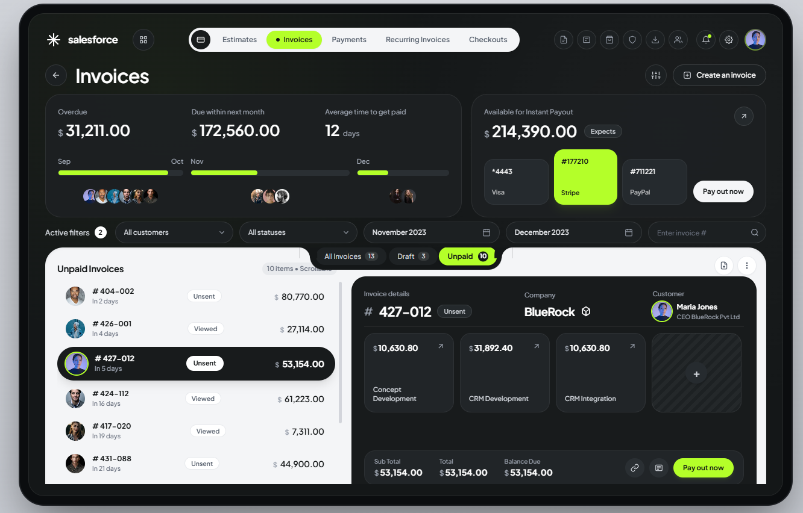

# Salesforce Financial Dashboard Template

Interactive, data-driven financial workspace UI — invoices, estimates, payments, recurring plans, and checkout links in one dashboard. Pure HTML/CSS/JS, zero build step, zero framework.



## Features

- **5 workspace modules** — Invoices, Estimates, Payments, Recurring Invoices, Checkouts — with animated sliding-pill navigation
- **Live data rendering** — every KPI, progress bar, list row, and detail card renders from a single `MENU_DATA` store in `data.js`
- **Sub-menu tabs** with auto-computed record counts (All / Draft / Unpaid per module)
- **Filtering** — customer dropdown, status dropdown, live search, client avatar quick-filters, month-range toggles
- **Create records** via modal; new records appear instantly in the list and detail card
- **Add milestones** (line items) to any selected record; totals animate and recompute
- **Instant payout panel** with selectable gateways (Visa / Stripe / PayPal)
- **CSV-style detail breakdown**, animated number counters, toast notifications
- **CSV export** of the currently filtered list via the notch export button
- Fully self-contained — only external dependencies are Tailwind CDN, Google Fonts, and Unsplash placeholder avatars

## Project structure

```
salesforce-financial-dashboard/
├── index.html                            # Main page (markup + styles)
├── data.js                               # MENU_DATA seed data store (edit this)
├── app.js                                # Rendering + interaction logic
├── assets/
│   └── preview.png                       # README preview image
└── .github/
    └── ISSUE_TEMPLATE/                   # GitHub issue templates (optional)
```

## Getting started

No build tools required. Any of these works:

```bash
# Option 1 — just open the file
double-click index.html

# Option 2 — local server (recommended, avoids any file:// quirks)
npx serve .

# Option 3 — Python
python -m http.server 8080
```

Then open `http://localhost:8080`.

## Customizing the data

All content lives in `data.js` under a single `MENU_DATA` object. Edit it, reload, done — no HTML changes needed.

```js
const MENU_DATA = {
  invoices: {
    title: 'Invoices',
    createBtn: 'Create an invoice',
    detailType: 'Invoice details',
    primaryAction: 'Pay out now',
    kpi1: { label: 'Overdue', amount: 31211.00 },
    kpi2: { label: 'Due within next month', amount: 172560.00 },
    kpi3: { label: 'Average time to get paid', value: 12, unit: 'days' },
    bars: { p1Start: 'Sep', p1End: 'Oct', b1: 88, p2Start: 'Nov', b2: 42, p3Start: 'Dec', b3: 34 },
    payout: { title: 'Available for Instant Payout', amount: 214390.00, badge: 'Expects' },
    subMenus: [
      { id: 'all',   label: 'All Invoices', count: 13 },
      { id: 'draft', label: 'Draft',        count: 3 },
      { id: 'unpaid',label: 'Unpaid',       count: 10 }
    ],
    defaultSubMenu: 'unpaid',
    items: [
      {
        id: '427-012',
        dueText: 'In 5 days',
        status: 'Unsent',            // Unsent | Viewed | Paid | Scheduled
        subGroup: 'unpaid',          // 'unpaid' or 'draft' — used by sub-menu tabs
        amount: 53154.00,
        company: 'BlueRock',
        customer: 'Maria Jones',
        role: 'CEO BlueRock Pvt Ltd',
        avatar: 'https://…',
        lineItems: [
          { title: 'CRM Development', amount: 31892.40 }
        ]
      }
      // …more items
    ]
  },
  // estimates, payments, recurring, checkouts …
};
```

### Field reference

| Field | Purpose |
|---|---|
| `title` | Page heading shown in the header |
| `createBtn` | Label of the top-right create button |
| `detailType` | Label above the detail card number |
| `primaryAction` | Main button on the detail card |
| `kpi1` / `kpi2` | Currency KPI cards (`amount` is animated) |
| `kpi3` | Non-currency KPI (`value` + `unit`, e.g. days / %) |
| `bars` | Three progress bars (`b1`/`b2`/`b3` = percent 0–100) |
| `payout` | Instant-payout card (title, amount, badge) |
| `subMenus` | Tabs in the top notch; counts recompute automatically from `items` |
| `defaultSubMenu` | Tab selected when the module opens |
| `items[].subGroup` | Must be `'draft'` or `'unpaid'` to map onto sub-menu tabs |
| `items[].status` | Free text — shown as badge (`Paid` zeroes the balance) |
| `items[].lineItems` | Milestone cards in the detail breakdown |

### Add a new module

1. Add a key to `MENU_DATA` in `data.js` (copy an existing block as a starting point).
2. Add a button in `index.html` inside `#mainMenuContainer`:

```html
<button data-menu="contracts" onclick="switchMainMenu('contracts')" class="main-nav-btn relative z-10 px-4 py-1.5 rounded-full text-[12px] font-semibold transition-colors duration-200 flex items-center gap-1.5 text-gray-600 hover:text-black">
  <span class="nav-dot hidden w-1.5 h-1.5 rounded-full bg-[#111415]"></span>
  <span>Contracts</span>
</button>
```

The sliding pill, sub-menus, filters, and detail card all pick it up automatically.

## Deploying to GitHub Pages

1. Push this folder to a GitHub repository.
2. **Settings → Pages → Source**: select the branch (e.g. `main`) and `/ (root)`.
3. Your dashboard is live at `https://<user>.github.io/<repo>/`.

## Tech stack

| Layer | Choice |
|---|---|
| Markup | Single HTML file, semantic sections |
| Styling | Tailwind CSS (CDN) + custom CSS for animations/notch/scrollbars |
| Fonts | Plus Jakarta Sans, Inter (Google Fonts) |
| Logic | Vanilla ES6, no framework, no bundler |
| Data | Plain JS object (`data.js`) |

## Browser support

Any modern Chromium/Firefox/Safari release. Uses CSS `backdrop-filter`, CSS `clamp`-free fixed tablet frame, and `execCommand` clipboard fallback.

## License

MIT — use it, fork it, ship it.
